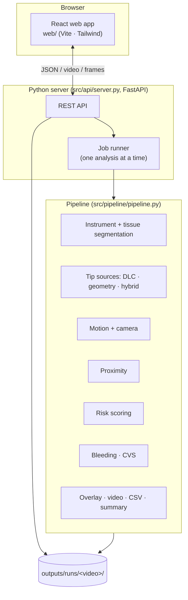
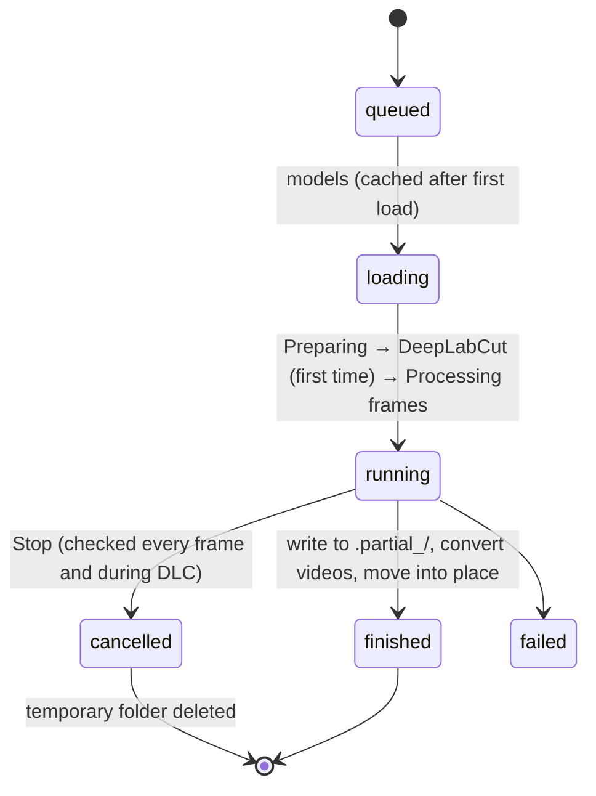

# Architecture — PRISM-Endo

## 1. Overview



## 2. Pipeline stages

| Stage | Module | Model / method | Notes |
|---|---|---|---|
| A. Instrument masks | `src/segmentation` | U-Net (ResNet encoder), 256×448 | `outputs/models/instrument_seg_multivideo` |
| B. Tips | `src/tracking` | DeepLabCut v3 (L-hook) + geodesic mask geometry (grasper jaw hinge) | DLC runs once per video in a subprocess, cached in `outputs/dlc/auto_analyze/` |
| C. Motion | `src/motion` | EMA-smoothed trajectories, camera affine | speed, direction, abrupt changes |
| D. Tissue | `src/tissue` | U-Net, 12 CholecSeg8k classes; optional DSAD fine-tune | per-class reliability from `class_support.json` |
| E. Proximity | `src/proximity` | distance transform to target masks | approximate mm from 5 mm shaft width |
| F. Risk | `src/risk` | rule-based weighted score + explanation | categories Minimal / Low / Medium / High |
| G. Safety | `src/safety` | bleeding U-Net (SurgBlood), CVS ResNet-50 (Endoscapes) | sampled every 0.5 s / 1 s |
| H. Output | `src/pipeline/overlay.py` | targets, leader lines, legend, risk banner | H.264 copies for the browser |

Configuration: `configs/pipeline.yaml` (models, targets, surgery types, thresholds).

## 3. Server and API

FastAPI app `src/api/server.py`, port 8510, serving the built web app from `web/dist`.

| Method | Path | Purpose |
|---|---|---|
| GET | `/api/meta` | videos, surgery types, tissue classes with reliability, defaults |
| GET | `/api/runs` | saved analyses with small stats |
| GET | `/api/runs/{name}` | summary + per-frame series |
| GET | `/api/runs/{name}/video/{original\|annotated}` | video with byte ranges |
| GET | `/api/runs/{name}/frame/{i}?w=&kind=` | one frame as JPEG (thumbnails) |
| GET | `/api/runs/{name}/file/{video\|csv\|summary}` | downloads |
| GET/PUT | `/api/runs/{name}/flags` | reviewer flags (`review_flags.json`) |
| POST | `/api/upload` | upload a video to `outputs/uploads/` |
| POST | `/api/run` | start an analysis (409 if one is running) |
| GET | `/api/jobs/{id}` · `/api/active` | progress, phase, status |
| POST | `/api/jobs/{id}/cancel` | stop |
| GET | `/api/llm/status` | whether a gpt-oss key is configured, model name |
| POST | `/api/runs/{name}/explain?refresh=` | gpt-oss explanation from a numbers-only summary (`src/api/explain.py`), cached in `explanation.json` |

### Job lifecycle



A run writes into `outputs/runs/.partial_<job>/` and replaces `outputs/runs/<video>/` only when complete, keeping
reviewer flags of the run it replaces.

## 4. Web app

React 18 + TypeScript, Vite, Tailwind 4, Geist. Main parts:

| File | Role |
|---|---|
| `web/src/App.tsx` | layout, data loading, video sync, keyboard shortcuts, toasts |
| `web/src/components/Sidebar.tsx` | new analysis form, tissue annotation, progress/stop, saved analyses |
| `web/src/components/StackedTimeline.tsx` | multi-track timeline, zoom, markers, thumbnails |
| `web/src/components/Charts.tsx` | risk-coloured line/area chart, risk strip |
| `web/src/components/Panels.tsx` | summary, events, flags, settings, downloads, dialogs |
| `web/src/components/Select.tsx` | accessible themed dropdown |
| `web/src/lib/derive.ts` | tracks, events, milestones, summary bullets |

Performance: heavy components are memoised; the playhead updates at 10 Hz; the inspector frame is fetched once the
playhead settles.

## 5. Performance

| Item | Value (AMD RX 6800M, DirectML) |
|---|---|
| Processing | ~5–6 frames/s |
| Start after a settings change | ~0.3 s (models cached across runs) |
| Stop | ~0.2 s |
| First DLC analysis of a new video | once, cached afterwards |

## 6. Storage layout

```
outputs/
├── runs/<video>/        annotated.mp4, *_h264.mp4, results.csv, summary.json, review_flags.json
├── dlc/auto_analyze/    cached DeepLabCut predictions per video
├── models/              trained weights (not in git)
└── uploads/             uploaded videos (not in git)
```
