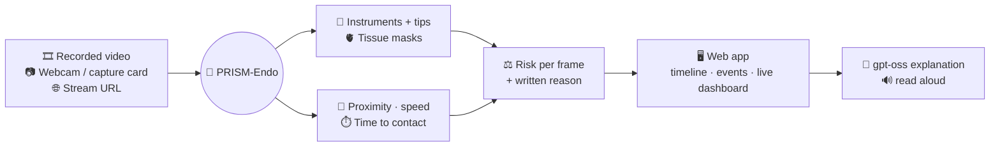
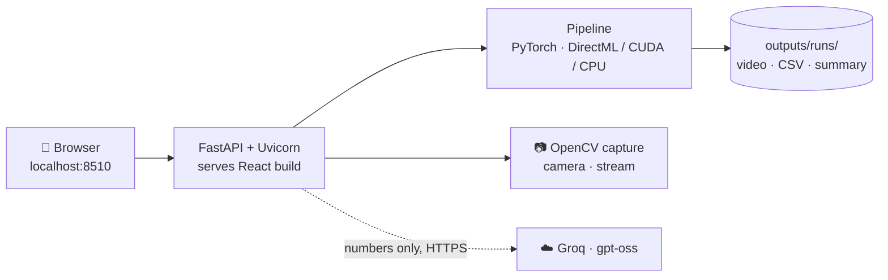
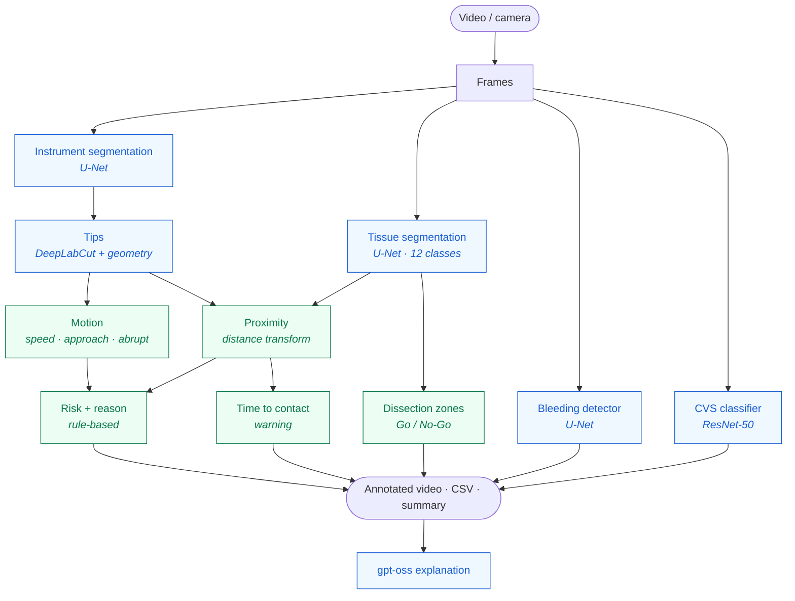
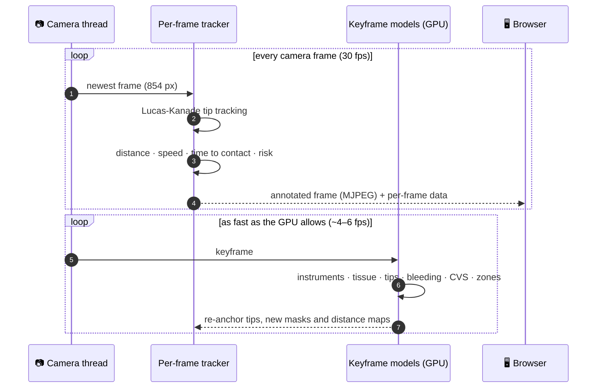

<div align="center">

# PRISM-Endo · Predictive Risk Intelligence for Endoscopic Surgery

**Turn laparoscopic video into frame-by-frame, explainable safety data: instruments, tips, tissue proximity, risk,
bleeding, Critical View of Safety and suggested dissection zones. Works on recorded video and live at 30 fps.**

Drop a video or connect a camera. PRISM-Endo tracks every instrument tip, measures how close it comes to the tissues
you choose, warns before contact, and explains the whole analysis in plain language.

[](LICENSE)


[**Quick start**](#-quick-start) ·
[**How it works**](#-how-it-works) ·
[**Features**](#-features) ·
[**Results**](#-results-on-held-out-data) ·
[**Docs**](#-documentation) ·
[**API**](#-api) ·
[**Project layout**](#-project-layout)

</div>

---

## 🧭 At a glance

> [!TIP]
> **Example.** A grasper tip is 12 px from the liver and moving towards it at 130 px/s. PRISM-Endo predicts
> **contact in 0.3 s**, flashes a red *CONTACT WARNING* on the video, raises the frame's risk to **Medium** with the
> reason *"tip 12px from liver (+0.42); approaching 130px/s (+0.12)"*, and logs the moment as an event on the
> timeline. Every number comes from measured geometry and transparent rules, not from a language model.



| | |
|---|---|
| **Problem** | Most of the risk in keyhole surgery is visible in the video, but reviewing hours of footage for near-misses is slow and subjective. Research tools look at instruments, anatomy, bleeding or CVS **separately**. |
| **Solution** | One pipeline that combines all of them, measures **tip-to-tissue distance and approach speed** every frame, predicts **time to contact**, and lets a reviewer jump straight to the moments that matter, offline or live. |
| **Guarantee** | Every risk value has a written reason. Every tissue is marked *tested / barely tested / not tested* on unseen patients. Every reported metric is held-out. |

### Project objectives

| Objective | Status | Where |
|---|---|---|
| Identify gaps in surgical risk prediction | ✅ Done | [docs/GAP_ANALYSIS.md](docs/GAP_ANALYSIS.md) |
| Extract, track and analyse tool motion and tissue proximity | ✅ Done | pipeline stages 1–5 |
| Predict pre-injury risk and generate visual warnings | ✅ Done | risk score, time-to-contact warning, No-Go zones |
| Real-time endoscopic video capture using OpenCV | ✅ Done | live capture at 30 fps with a live dashboard |

---

## 🚀 Quick start

> [!TIP]
> **Plug and play (shared zip).** Unzip, then double-click **`START.bat`**. The first run installs Python packages
> (internet needed, ~10 min); after that it starts in seconds and opens <http://localhost:8510>. Needs only
> [Python 3.11](https://www.python.org/downloads/release/python-3119/) (tick *Add python.exe to PATH*).

<details open>
<summary><b>Option A: Web app (recommended)</b></summary>

<br/>

Requires Windows, Python 3.11 and Node 20+.

```powershell
python -m venv .venv
.venv\Scripts\pip install -r requirements.txt     # AMD/Intel GPU: requirements-directml.txt in .venv-dml
cd web; npm install; npm run build; cd ..
.venv\Scripts\python -m uvicorn src.api.server:app --port 8510
```

Open **<http://localhost:8510>**.



| Action | How |
|---|---|
| Analyse a video | Drop a file or pick one, choose surgery type and tissues, **Analyse** |
| Go live | **Find live cameras**, pick a camera or paste an `rtsp://` / `http://` URL, **Analyse** |
| Keep a live session | **Finish & save**. Throw it away: **Discard** |
| Explain an analysis | **AI** → *Explain this analysis* → **Listen** |

> [!IMPORTANT]
> **Local and private by default.** Video never leaves the machine. The optional AI explanation sends only analysis
> numbers. `.env` (Groq key) is git-ignored. Trained weights and datasets are **not** in this repository; the
> pipeline reports missing models instead of failing.

</details>

<details>
<summary><b>Option B: Command line</b></summary>

<br/>

```powershell
.venv\Scripts\python run_pipeline.py --input path\to\video.mp4 --out outputs\runs\my_video
```

Writes `annotated.mp4`, `results.csv` and `summary.json` to the output folder.

</details>

<details>
<summary><b>Optional: AI explanation</b></summary>

<br/>

Copy `.env.example` to `.env` and set `GROQ_API_KEY` (free at <https://console.groq.com/keys>). Without it, the rest
of the app works unchanged and the AI panel says the explanation is unavailable.

</details>

---

## ⚙️ How it works

### The pipeline



<sub>🔵 learned model · 🟢 deterministic, transparent rules</sub>

### Live mode at 30 fps: keyframes + tracking

Running every model on every frame is too slow for live video, so live mode splits the work:



| Layer | Rate (laptop GPU, measured) | What runs |
|---|---|---|
| **Per frame** | **30 fps** (camera rate) | optical-flow tip tracking, distance from cached maps, speed, approach, **time to contact**, **risk level**, warnings, drawing |
| **Keyframes** | ~4–6 fps | full models: instrument + tissue segmentation, tips, bleeding, CVS, dissection zones |

Measured with a paced 720p feed: 29–30 fps on a 30 fps camera, 30.0 fps sustained on a 60 fps camera.

<details>
<summary><b>Pipeline in detail</b></summary>

<br/>

| Stage | How |
|---|---|
| **1. Instruments** | U-Net (ResNet encoder, 256 × 448) segments the **grasper** and **L-hook**; trained on 11 CholecSeg8k videos with a video-level split |
| **2. Tips (hybrid)** | **L-hook:** DeepLabCut model trained on human tip clicks, run once per video and cached. **Grasper:** geodesic rule on the mask, from where the instrument enters the view to the jaw hinge. Low-confidence tips are flagged, not silently trusted |
| **3. Motion** | EMA-smoothed trajectories: speed, direction, acceleration, abrupt changes, plus camera-motion estimation |
| **4. Tissue** | 12 classes, each marked *tested / barely tested / not tested* on unseen patients; an opt-in model fine-tuned on DSAD for other operations |
| **5. Proximity** | distance from each tip to the selected tissues; approximate mm from the 5 mm shaft width, always labelled approximate |
| **6. Risk** | transparent score, smoothed over time, with a written reason every frame (rules below) |
| **7. Safety models** | **Bleeding:** U-Net on SurgBlood, every 0.5 s. **CVS:** ResNet-50 on Endoscapes-CVS201, criteria C1–C3 every second |
| **8. Dissection zones** | green **Go** / red **No-Go** overlay for cholecystectomy, after GoNoGoNet and SAGES guidance ([details](docs/DISSECTION_ZONES.md)) |
| **9. AI explanation** | numbers-only summary → **gpt-oss** → *What happened · Key moments · Risk and safety · How far to trust this*; cached, read aloud on request |

</details>

<details>
<summary><b>Risk rules (deterministic, unit-tested)</b></summary>

<br/>

| Part | Weight | Meaning |
|---|---|---|
| Proximity | 0.50 | how close a tip is to a target tissue |
| Approach | 0.20 | how fast it moves **towards** that tissue (only counted near tissue) |
| Speed | 0.15 | how fast the tip moves overall |
| Abrupt change | 0.15 | sudden changes of direction or acceleration |

| Output | Rule |
|---|---|
| **Category** | **Minimal** < 0.25 ≤ **Low** < 0.5 ≤ **Medium** < 0.75 ≤ **High** |
| **Frame risk** | worst tip in the frame; no tip in view = no risk (0) |
| **Time to contact** | distance ÷ approach speed (approach ≥ 20 px/s) |
| **Contact warning** | time to contact ≤ 1 s, or the tip is touching the tissue |
| **No-Go zone** | Go = fibro-fatty tissue within 6 % of the gallbladder edge; No-Go = danger structures + 3 % margin and tissue > 16 % from the gallbladder (fractions of the image diagonal) |

All thresholds live in [`configs/pipeline.yaml`](configs/pipeline.yaml).

</details>

---

## ✨ Features

| | Feature | Details |
|---|---|---|
| 🎞️ | **Any source** | MP4, MOV, AVI, MKV, WEBM, webcam / capture card (`camera:0`) or `rtsp://` / `http://` stream |
| 🔧 | **Instrument tracking** | masks, tips, smoothed trajectories, speed, direction, abrupt-change flags |
| 📏 | **Tissue proximity** | distance from every tip to the tissues you choose (all selected by default) |
| ⏱️ | **Pre-contact warning** | time to contact with a pulsing red alert on the video, events and a timeline track |
| ⚖️ | **Risk per frame** | Minimal → High with a plain-language reason for every frame, offline and live |
| 🟩 | **Dissection zones** | green Go / red No-Go overlay on gallbladder video; tip-in-No-Go events |
| 🩸 | **Bleeding** | learned detector with an outline on the video |
| ✅ | **Critical View of Safety** | estimate of the three CVS criteria |
| 📡 | **Live dashboard** | 30 fps view; risk, distance, speed and time-to-contact charts for every frame; last 60 s by default with scroll, zoom and pan; per-second table; live events |
| 🧾 | **Review** | synced annotated + original video, stacked timeline, milestones, events, frame inspector, "Why this risk" |
| 🤖 | **AI explanation** | gpt-oss report in a resizable side panel, **Listen** with voice, speed and sentence highlighting |
| 🚩 | **Reviewer flags** | *agree · AI wrong · important*, saved per analysis to build validation data |
| 🔀 | **Compare · export · print** | side-by-side analyses, video / CSV / JSON downloads, one-page summary |
| 🌗 | **Accessible** | keyboard control (`Space`, `D/F`, `J/K`, `1/2/3`, `T`, `?`), light and dark, WCAG 2 AA, reduced motion |

<details>
<summary><b>Advantages</b></summary>

<br/>

- **Explainable, not a black box:** every risk value comes with a reason (which tip, which tissue, how close, how fast).
- **Honest about reliability:** tissues are marked tested / not tested, low-confidence tips are shown as such.
- **Evaluated on unseen patients:** patient-level splits and a leakage audit; every reported number is held-out.
- **Many signals in one view:** instruments, tips, motion, proximity, zones, bleeding and CVS on one synced timeline.
- **Real time:** 30 fps live analysis with per-frame risk on a laptop GPU.
- **Privacy-friendly:** runs locally; the optional AI explanation sends only numbers, never video.
- **Ordinary hardware:** NVIDIA, AMD/Intel (DirectML) or CPU; models cached, analyses start in ~0.3 s and stop instantly.
- **Builds its own validation data:** reviewer flags capture expert agreement and corrections.

</details>

---

## 📊 Results on held-out data

All numbers are measured on patients or clips the model **never saw during training**.

| Component | Result |
|---|---|
| Instrument segmentation | Dice **0.852** grasper, **0.840** L-hook |
| Tissue segmentation (gallbladder surgery) | mean Dice **0.735**; liver 0.843, gallbladder 0.842, fat 0.933 |
| Tissue model for other surgeries (opt-in) | Dresden Surgical Anatomy test Dice 0.38 → **0.85**; false "liver" on an appendicectomy roughly halved |
| L-hook tip, leakage-free test | DeepLabCut median **6.5 px**, 35/35 found, 91 % within 20 px |
| Grasper tip (geometry) | median ≈ 67 px on 5 videos (rough; needs more human labels) |
| Bleeding detection | F1 **0.937**, AUROC 0.942 |
| Critical View of Safety | mAP **0.539** on 40 unseen videos |
| Speed | recorded video ~5–6 fps (all models, every frame); live **30 fps** per frame |

<details>
<summary><b>How we evaluated</b></summary>

<br/>

- **Patient-level splits:** train, validation and test are split by video/patient, never by frame.
- **Held-out only:** no result here comes from training data.
- **Leakage audit:** an early DeepLabCut result was optimistic because its starting model had seen the test videos; the
  leakage-free re-run (6.5 px) is in [docs/DLC_CLEAN_EVALUATION.md](docs/DLC_CLEAN_EVALUATION.md).
- **Honest negatives:** approaches that did not hold up were rejected and documented, not shipped.
- **Not yet validated:** the dissection zones are a rule-based approximation and have not been compared with expert
  annotations ([docs/DISSECTION_ZONES.md](docs/DISSECTION_ZONES.md)).

</details>

---

## 📦 Outputs

Each analysis is saved in `outputs/runs/<video>/`:

| File | Contents |
|---|---|
| `annotated.mp4` / `annotated_h264.mp4` | video with instruments, tips, tissue outlines, zones, risk banner, warnings, legend |
| `results.csv` | one row per frame: instruments, tips, motion, proximity per target, time to contact, risk and reason, zones, bleeding, CVS |
| `summary.json` | settings, models used, per-category counts, run time, warnings |
| `live_fast.csv` | live sessions only: every tracked frame with distance, speed, time to contact and risk |
| `review_flags.json` | reviewer flags from the web app |
| `explanation.json` | cached gpt-oss explanation |

---

## 📚 Documentation

| Document | What's inside |
|---|---|
| 📋 [**PRD.md**](PRD.md) | Goals, users, scope, requirements, success metrics |
| 🏗️ [**ARCHITECTURE.md**](ARCHITECTURE.md) | Components, data flow, API, job lifecycle, performance |
| 🤖 [**AGENTS.md**](AGENTS.md) | Rules and conventions for coding tools working on this repo |
| 🎨 [**DESIGN_SYSTEM.md**](DESIGN_SYSTEM.md) | Web app tokens, typography, components, accessibility |
| ✅ [**QA_REPORT.md**](QA_REPORT.md) | Test strategy, coverage, defects found and fixed |
| 🔍 [docs/GAP_ANALYSIS.md](docs/GAP_ANALYSIS.md) | Gaps in surgical risk prediction and how PRISM-Endo addresses them |
| 🟩 [docs/DISSECTION_ZONES.md](docs/DISSECTION_ZONES.md) | Go / No-Go zones: literature, rules, limits |
| 🛠️ [docs/TECHNICAL_GUIDE.md](docs/TECHNICAL_GUIDE.md) | Every command, training run and measurement |
| 🎯 [docs/DLC_CLEAN_EVALUATION.md](docs/DLC_CLEAN_EVALUATION.md) | Leakage-free DeepLabCut evaluation |
| 🗃️ [docs/DATASETS.md](docs/DATASETS.md) | Data layout and splits |
| 🩺 [docs/CLINICAL_REVIEW_PACKAGE.md](docs/CLINICAL_REVIEW_PACKAGE.md) | Package for surgeon review |

---

## 🔌 API

| Method | Path | Purpose |
|---|---|---|
| `GET` | `/api/meta` | Surgery types, tissues and their reliability, inputs, defaults |
| `GET` | `/api/runs` · `/api/runs/{name}` | List analyses · one analysis (summary + per-frame data) |
| `GET` | `/api/runs/{name}/video/{kind}` | Annotated or original video (H.264, range requests) |
| `GET` | `/api/runs/{name}/frame/{idx}` | One annotated frame as an image |
| `GET` | `/api/runs/{name}/file/{kind}` | Download CSV / JSON / video |
| `GET` · `PUT` | `/api/runs/{name}/flags` | Reviewer flags |
| `POST` | `/api/runs/{name}/explain` | gpt-oss explanation (cached) · `GET /api/llm/status` |
| `POST` | `/api/upload` | Upload a video |
| `POST` | `/api/run` | Start an analysis (file, camera or stream) |
| `GET` | `/api/jobs/{id}` · `/api/active` | Job progress, phase, live fps, risk, warning |
| `POST` | `/api/jobs/{id}/cancel` · `/finish` | Stop and discard · finish and save a live session |
| `GET` | `/api/cameras` | Find connected cameras |
| `GET` | `/api/live/{id}.mjpg` | Live annotated view (MJPEG) |
| `GET` | `/api/live/{id}/data?since=N` | Live per-frame series, events and status after frame N |

---

## 🧪 Tests

```powershell
.venv\Scripts\python -m pytest -q     # 128 unit tests: pipeline, risk, tracking, live, zones, API
cd web; npm run test:e2e               # 21 browser tests: every control, light/dark, 4 sizes, axe accessibility
```

Details in [QA_REPORT.md](QA_REPORT.md).

---

## 🗂️ Project layout

<details>
<summary><b>Expand the tree</b></summary>

```
src/
  pipeline/      end-to-end pipeline, overlay drawing
  segmentation/  U-Net training, prediction, temporal smoothing
  tracking/      DeepLabCut / geometry / hybrid tip sources
  motion/        tip kinematics, camera motion
  tissue/        tissue segmenter + per-class reliability
  proximity/     tip-to-tissue distance, approximate mm scale
  risk/          rule-based (and learned) risk scoring
  safety/        bleeding, Critical View of Safety, dissection zones
  api/           FastAPI server, live tracker (live_fast.py), gpt-oss explanation
  ui/            training dashboard (+ legacy Streamlit app)
web/             React app (src/components, src/lib) + Playwright tests
configs/         pipeline.yaml and training configs
scripts/         training, evaluation, data and DLC tooling
tests/           pytest suite
docs/            technical guide, evaluations, reports
```

</details>

<details>
<summary><b>Five files to read first</b></summary>

1. [`src/pipeline/pipeline.py`](src/pipeline/pipeline.py): the whole pipeline, frame by frame
2. [`src/risk/rule_based.py`](src/risk/rule_based.py): the risk maths
3. [`src/api/live_fast.py`](src/api/live_fast.py): 30 fps live tracking, per-frame risk and live data
4. [`src/safety/dissection_zones.py`](src/safety/dissection_zones.py): Go / No-Go zones
5. [`web/src/App.tsx`](web/src/App.tsx): the web app shell

</details>

---

## 🗃️ Datasets and licences

The **code** is MIT-licensed. **Datasets and trained weights are not included** and keep their own licences.

| Dataset | Used for | Licence |
|---|---|---|
| [CholecSeg8k](https://www.kaggle.com/datasets/newslab/cholecseg8k) | instrument + tissue segmentation | CC BY-NC-SA 4.0 |
| [DSAD (Dresden Surgical Anatomy)](https://huggingface.co/datasets/nct-tso/dsad) | tissue model for other surgeries | CC BY 4.0 |
| [Endoscapes-CVS201](https://github.com/CAMMA-public/Endoscapes) | Critical View of Safety | CC BY-NC-SA 4.0 |
| SurgBlood (public test release) | bleeding detection | see dataset terms |
| EndoVis 2015 tracking (Du et al.) | robotic keypoint experiment | see challenge terms |

Models trained on non-commercial (NC) data inherit those restrictions.

<details>
<summary><b>Tech stack and performance</b></summary>

<br/>

| Layer | Technology |
|---|---|
| Models | PyTorch, segmentation-models-pytorch (U-Net), torchvision (ResNet-50), DeepLabCut 3 |
| GPU | CUDA, or AMD/Intel via DirectML on Windows; CPU fallback |
| Video | OpenCV (capture, optical flow), ffmpeg (H.264 for browsers) |
| Server | FastAPI + Uvicorn |
| Web | React 18, TypeScript, Vite, Tailwind CSS 4, Geist |
| AI text | gpt-oss via Groq's OpenAI-compatible API; browser Web Speech API for read-aloud |
| Tests | pytest, Playwright, axe-core |

| Measure | Value (AMD RX 6800M laptop GPU) |
|---|---|
| Recorded-video analysis (all models, every frame) | ~5–6 frames/s |
| Live analysis | **30 fps** per frame, keyframes ~4–6 fps |
| Start after a settings change | ~0.3 s (models cached) |
| Stop an analysis | ~0.2 s |
| AI explanation | ~2 s |

</details>

<details>
<summary><b>Roadmap</b></summary>

<br/>

- [ ] Surgeon review and clinical sign-off
- [ ] Expert-labelled Go / No-Go zones and a learned model for them
- [ ] Learned grasper-tip model from more human labels
- [ ] Learned injury-risk model from expert event labels
- [ ] Camera calibration for true millimetres
- [ ] Full models on every live frame (ONNX / TensorRT)
- [ ] Hosted deployment with a permanent URL

</details>

<details>
<summary><b>Acknowledgements and citation</b></summary>

<br/>

PRISM-Endo builds on **CholecSeg8k**, the **Dresden Surgical Anatomy Dataset**, **Endoscapes-CVS201** (CAMMA),
**SurgBlood**, **EndoVis**, **DeepLabCut**, **segmentation-models-pytorch**, **PyTorch**, **OpenCV**, **gpt-oss** and
**Groq**, and on the GoNoGoNet work of Madani et al. and SAGES safe-cholecystectomy guidance. Thanks to their authors
and annotators.

```bibtex
@software{prism_endo_2026,
  title  = {PRISM-Endo: Predictive Risk Intelligence System for Endoscopic Surgery},
  year   = {2026},
  url    = {https://github.com/SeptuaJananiB/Prism_Endo}
}
```

</details>

---

<div align="center">
<sub>Measured geometry, transparent rules, honest numbers. Released under the <a href="LICENSE">MIT License</a>.</sub>
</div>
