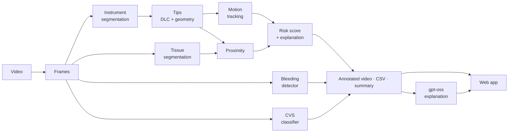

<div align="center">

# PRISM-Endo

### Predictive Risk Intelligence System for Endoscopic Surgery

**Instrument tracking, tissue proximity, bleeding and Critical View of Safety — frame by frame, from laparoscopic video, explained in plain language.**

[](LICENSE)


</div>


---

## Contents

1. [Project objectives](#project-objectives) · [Why PRISM-Endo](#why-prism-endo)
2. [What it does](#what-it-does)
3. [Results on held-out data](#results-on-held-out-data)
4. [How it works](#how-it-works)
5. [Pipeline in detail](#pipeline-in-detail)
6. [The web app](#the-web-app)
7. [Outputs](#outputs)
8. [How we evaluated](#how-we-evaluated)
9. [Quick start](#quick-start)
10. [Tech stack and performance](#tech-stack-and-performance)
11. [Project structure](#project-structure)
12. [Documentation](#documentation)
13. [Datasets and licences](#datasets-and-licences)
14. [Advantages](#advantages)
15. [Roadmap](#roadmap)
16. [Acknowledgements](#acknowledgements) · [Citation](#citation) · [License](#license)

---

## Project objectives

| Objective | Status | Where |
|---|---|---|
| Identify gaps in surgical risk prediction | ✅ Done | [docs/GAP_ANALYSIS.md](docs/GAP_ANALYSIS.md) |
| Extract, track and analyse tool motion and tissue proximity | ✅ Done | pipeline stages 1–5 below |
| Predict pre-injury risk and generate visual warnings | ✅ Done | risk score + time-to-contact warning (stage 6) |
| Real-time endoscopic video capture using OpenCV | ✅ Done | live capture at 30 fps (stage 8) |

## Why PRISM-Endo

Laparoscopic (keyhole) surgery is performed through small incisions while the surgeon watches a camera feed.
Most of the risk lives in that video: an instrument moving too fast, a tip working millimetres from a critical
structure, bleeding that starts quietly, or clipping before the anatomy is properly exposed — the
**Critical View of Safety (CVS)**, the recognised safety check before dividing structures in gallbladder surgery.

Reviewing hours of surgical video for these moments is slow and subjective. PRISM-Endo turns a video into
**structured, explainable, frame-by-frame data** — where every instrument and tissue is, how the tips move, how
close they come to chosen structures, when bleeding appears and whether CVS is reached — and lets a reviewer jump
straight to the moments that matter. Every number comes with an honest statement of how far it can be trusted.

## What it does

| Output | How |
|---|---|
| **Instrument masks** (grasper, L-hook) | U-Net segmentation |
| **Instrument tips** | DeepLabCut for the L-hook + mask geometry for the grasper (*hybrid*) |
| **Tip motion** | smoothed trajectories, speed, direction, abrupt-change flags, camera-motion estimate |
| **Tissue masks** | 12 CholecSeg8k classes, each with a *tested / not tested* reliability flag |
| **Tip-to-tissue proximity** | distance from every tip to the target tissues you choose |
| **Risk indicator** | explainable rule-based score (Minimal → High) with a plain-language reason per frame |
| **Pre-contact early warning** | predicted **time to contact** (distance ÷ approach speed) with a pulsing on-video alert, events and a timeline track |
| **Live capture** | real-time analysis from a webcam, capture card or stream URL (OpenCV), shown live in the browser |
| **Bleeding** | learned detector (SurgBlood) with an outline on the video |
| **Critical View of Safety** | learned estimate of the three CVS criteria (Endoscapes) |
| **AI explanation** | **gpt-oss** writes what happened in the video, key moments and risk findings — read aloud on request |

Everything is written to an **annotated video**, a **per-frame CSV** and a **run summary**, and explored in a
**web app** with a synced timeline, events, reviewer flags and comparisons.

## Results on held-out data

All numbers are measured on patients or clips that the model **never saw during training**.

| Component | Result |
|---|---|
| Instrument segmentation | Dice **0.852** grasper, **0.840** L-hook |
| Tissue segmentation (gallbladder surgery) | mean Dice **0.735**; liver 0.843, gallbladder 0.842, fat 0.933 |
| Tissue model for other surgeries (opt-in) | Dresden Surgical Anatomy test Dice 0.38 → **0.85**; false "liver" on an appendicectomy roughly halved |
| L-hook tip, leakage-free test | DeepLabCut median **6.5 px**, 35/35 found, 91 % within 20 px |
| Grasper tip (geometry) | median ≈ 67 px on 5 videos — rough; needs more human labels |
| Bleeding detection | F1 **0.937**, AUROC 0.942 |
| Critical View of Safety | mAP **0.539** on 40 unseen videos |
| Speed | ~5–6 frames/s on an AMD RX 6800M (DirectML) — not real time |

Details and history: [docs/TECHNICAL_GUIDE.md](docs/TECHNICAL_GUIDE.md) · [docs/PROJECT_STATUS_REPORT.md](docs/PROJECT_STATUS_REPORT.md).

## How it works



## Pipeline in detail

### 1. Instrument segmentation
A U-Net (ResNet encoder, 256 × 448 input) segments the **grasper** and **L-hook** in every frame. It was trained on
11 CholecSeg8k videos with a video-level split, so the test patients are completely unseen.

### 2. Instrument tips — *hybrid* keypoints
- **L-hook:** a **DeepLabCut** model trained on human tip clicks. The first time a video is analysed, DLC runs over
  it once (cancellable) and the result is cached.
- **Grasper:** a geometric rule on the instrument mask — follow the instrument from where it enters the view
  (geodesic distance inside the mask) to the jaw hinge, 90 px back from the far end.
- Tips with low confidence are flagged and shown hatched in the timeline instead of being silently trusted.

### 3. Motion
Tips are smoothed (EMA) and tracked over time: speed, direction, acceleration and abrupt trajectory changes, with an
estimate of camera motion so that a moving camera is not mistaken for a moving instrument.

### 4. Tissue segmentation and reliability
A second U-Net labels 12 tissue classes. For every class, PRISM-Endo knows how it performed on unseen patients and
marks it **tested**, **barely tested** or **not tested** — e.g. the cystic duct is too rare in the test set to be
trusted. A second, opt-in model fine-tuned on the Dresden Surgical Anatomy Dataset handles non-gallbladder
operations (**Surgery type → Other**).

### 5. Proximity
For each tip, the distance (distance transform) to the selected target tissues. An approximate millimetre value is
estimated from the known 5 mm instrument-shaft width and always labelled *approximate*.

### 6. Risk score
A transparent, rule-based score built from four parts, smoothed over time:

| Part | Weight | Meaning |
|---|---|---|
| Proximity | 0.50 | how close a tip is to a target tissue |
| Approach | 0.20 | how fast it is moving **towards** that tissue |
| Speed | 0.15 | how fast the tip moves overall |
| Abrupt change | 0.15 | sudden changes of direction or acceleration |

**Pre-contact early warning:** for every tip, PRISM-Endo predicts the **time to contact** with the nearest target
tissue (distance ÷ speed towards it). When contact is predicted within **1 s** (configurable), the video shows a
pulsing red border with *"CONTACT WARNING — grasper tip → liver in 0.6 s"*, and the moment appears as an event,
a milestone and a timeline track.

Categories: **Minimal** < 0.25 ≤ **Low** < 0.5 ≤ **Medium** < 0.75 ≤ **High**. Every frame carries the reason, e.g.
*"Grasper tip: Medium — tip 5 px from liver (+0.46); moving towards liver at 184 px/s (+0.14)"*.

### 7. Safety models
- **Bleeding:** U-Net trained on SurgBlood (split by clip), sampled every 0.5 s, outlined on the video.
- **Critical View of Safety:** ResNet-50 trained on Endoscapes-CVS201 surgeon labels, estimating each of the
  three criteria (C1–C3) every second.

### 8. Live capture (real time)
OpenCV opens a **webcam or capture card** (`camera:0`) or a **stream URL** (`rtsp://`, `http://`). Frames are read
as they arrive — stale buffered frames are dropped so the analysis stays in sync with the camera — and each annotated
frame is streamed to the browser as a live view, with the current risk and any contact warning. **Finish & save**
keeps the session as a normal analysis; **Discard** throws it away.

**30 fps live analysis — keyframes + tracking.** Running every model on every frame is too slow for live video, so
live mode splits the work:

| Layer | Rate (laptop GPU, measured) | What runs |
|---|---|---|
| **Per-frame** | **30 fps** (camera rate) | Lucas-Kanade optical-flow tip tracking, distance to tissue from cached distance maps, speed, approach speed, **time to contact**, contact warning, drawing |
| **Keyframes** | ~4–6 fps | full models: instrument + tissue segmentation, tips, bleeding, CVS — re-anchor the tracked tips |

Frames are captured on a dedicated thread (newest frame always used, downscaled to 854 px), drawing and JPEG encoding
run on a separate display thread, and every per-frame result is logged to `live_fast.csv`. Measured with a paced
720p camera feed: 29–30 fps on a 30 fps camera and 30.0 fps sustained on a 60 fps camera.

### 9. AI explanation (gpt-oss)
A compact, **numbers-only** summary of the analysis (risk timeline, events, bleeding, CVS, instruments, settings —
never video or frames) is sent to **gpt-oss** on an OpenAI-compatible API (Groq). It writes:
*What happened in the video · Key moments · Risk and safety · How far to trust this*. The prompt forbids inventing
anything that is not in the data and forbids medical advice. Explanations are cached per analysis and can be
**read aloud** with the browser's built-in speech engine.

## The web app

A calm, review-focused interface (React · Vite · Tailwind · FastAPI) with a landing page and loading screen:

- **Analyse** — upload or pick a video, choose surgery type, tip source and the tissues to measure (all by default);
  live progress with the current phase and an instant **Stop** that never damages earlier results.
- **Review** — synced annotated + original video, KPI cards, a **stacked timeline** (risk, bleeding, CVS,
  instruments, proximity) with drag-to-zoom, milestones and thumbnails, **"Why this risk"**, event list, risk chart
  coloured by risk level, frame inspector, analysis settings.
- **Explain** — the **AI explanation** sits in a resizable right-hand panel, with **Listen** (voice, speed,
  sentence highlighting).
- **Annotate** — reviewer flags (*agree · AI wrong · important*) saved with each analysis, building a human-labelled
  set for future validation.
- **Compare · export · print** — compare two analyses side by side, download video / CSV / JSON, print a summary.
- **Accessible** — full keyboard control (`Space`, `D/F`, `J/K`, `1/2/3`, `T`, `?`), light and dark themes,
  WCAG 2 AA contrast (checked automatically), reduced-motion support, resizable side panels.

Design rules: [DESIGN_SYSTEM.md](DESIGN_SYSTEM.md).

## Outputs

Each analysis is saved in `outputs/runs/<video>/`:

| File | Contents |
|---|---|
| `annotated.mp4` / `annotated_h264.mp4` | video with instruments, tips, tissue outlines, risk banner, legend |
| `results.csv` | one row per frame: instruments, tip positions and status, motion, proximity per target, risk score, category and explanation, bleeding, CVS, approximate mm |
| `summary.json` | settings, models used, per-category counts, run time, warnings |
| `review_flags.json` | reviewer flags from the web app |
| `explanation.json` | cached gpt-oss explanation |

## How we evaluated

- **Patient-level splits.** Train, validation and test sets are split **by video/patient**, never by frame, so a test
  patient is never seen in training.
- **Held-out only.** No result in this README comes from training data.
- **Leakage audit.** An early DeepLabCut result turned out to be optimistic because its starting model had seen the
  test videos; a fully leakage-free re-run (6.5 px) is documented in
  [docs/DLC_CLEAN_EVALUATION.md](docs/DLC_CLEAN_EVALUATION.md).
- **Honest negatives.** Approaches that did not hold up on held-out data were rejected and documented rather than
  shipped (e.g. a tissue model that improved other surgeries but lost accuracy on gallbladder surgery became an
  opt-in instead of the default).
- **Software quality.** 120 unit tests and 21 end-to-end browser tests (every control, light/dark, four screen sizes,
  accessibility scan) — see [QA_REPORT.md](QA_REPORT.md).

## Quick start

> Windows · Python 3.11 · Node 20+. Trained weights and datasets are **not** in this repository (see
> [Datasets and licences](#datasets-and-licences)); the pipeline reports missing models instead of failing.

```powershell
# 1. Python environment (CPU/CUDA); use requirements-directml.txt in .venv-dml for AMD/Intel GPUs
python -m venv .venv
.venv\Scripts\pip install -r requirements.txt

# 2. Analyse a video from the command line
.venv\Scripts\python run_pipeline.py --input path\to\video.mp4 --out outputs\runs\my_video

# 3. Build and start the web app
cd web; npm install; npm run build; cd ..
.venv\Scripts\python -m uvicorn src.api.server:app --port 8510
# open http://localhost:8510
```

**Optional AI explanation:** copy `.env.example` to `.env` and set `GROQ_API_KEY` (free at console.groq.com).
Only analysis numbers are sent; `.env` is never committed.

**Tests:**

```powershell
.venv\Scripts\python -m pytest -q        # unit tests
cd web; npm run test:e2e                  # browser tests (server running)
```

## Tech stack and performance

| Layer | Technology |
|---|---|
| Models | PyTorch, segmentation-models-pytorch (U-Net), torchvision (ResNet-50), DeepLabCut 3 |
| GPU | CUDA, or AMD/Intel via DirectML on Windows; CPU fallback with optional ONNX Runtime |
| Video | OpenCV, ffmpeg (H.264 for browsers) |
| Server | FastAPI + Uvicorn |
| Web | React 18, TypeScript, Vite, Tailwind CSS 4, Geist |
| AI text | gpt-oss (OpenAI open-weight) via Groq's OpenAI-compatible API; browser Web Speech API for read-aloud |
| Tests | pytest, Playwright, axe-core |

| Measure | Value (AMD RX 6800M laptop GPU) |
|---|---|
| Recorded-video analysis (all models, every frame) | ~5–6 frames/s |
| Live analysis (per-frame tracking + keyframes) | **30 fps** per frame, keyframes ~4–6 fps |
| Start an analysis after a settings change | ~0.3 s (models cached) |
| Stop an analysis | ~0.2 s |
| AI explanation | ~2 s |

## Project structure

```
PRISM-Endo/
├── src/
│   ├── pipeline/      end-to-end pipeline, overlay drawing
│   ├── segmentation/  U-Net training, prediction, temporal smoothing
│   ├── tracking/      DeepLabCut / geometry / hybrid tip sources
│   ├── motion/        tip kinematics, camera motion
│   ├── tissue/        tissue segmenter + per-class reliability
│   ├── proximity/     tip-to-tissue distance, approximate mm scale
│   ├── risk/          rule-based (and learned) risk scoring
│   ├── safety/        bleeding detector, Critical View of Safety
│   ├── api/           FastAPI server and gpt-oss explanation
│   └── ui/            training dashboard (+ legacy Streamlit app)
├── web/               React web app + Playwright tests
├── configs/           pipeline and training configs
├── scripts/           training, evaluation, data and DLC tooling
├── tests/             unit tests (pytest)
├── docs/              technical guide, evaluations, reports
└── status/            project status board
```

## Documentation

| Document | What it covers |
|---|---|
| [PRD.md](PRD.md) | Goals, users, scope, requirements, success metrics |
| [ARCHITECTURE.md](ARCHITECTURE.md) | Components, data flow, API, job lifecycle, performance |
| [DESIGN_SYSTEM.md](DESIGN_SYSTEM.md) | Web app tokens, typography, components, accessibility |
| [QA_REPORT.md](QA_REPORT.md) | Test strategy, coverage, defects found and fixed |
| [AGENTS.md](AGENTS.md) | Rules for automated coding tools working on this repo |
| [docs/GAP_ANALYSIS.md](docs/GAP_ANALYSIS.md) | Gaps in surgical risk prediction and how PRISM-Endo addresses them |
| [docs/TECHNICAL_GUIDE.md](docs/TECHNICAL_GUIDE.md) | Every command, training run and measurement |
| [docs/DLC_CLEAN_EVALUATION.md](docs/DLC_CLEAN_EVALUATION.md) | Leakage-free DeepLabCut evaluation |
| [docs/DATASETS.md](docs/DATASETS.md) | Data layout and splits |
| [docs/CLINICAL_REVIEW_PACKAGE.md](docs/CLINICAL_REVIEW_PACKAGE.md) | Package for surgeon review |

## Datasets and licences

The **code** is MIT-licensed. **Datasets and trained weights are not included** and keep their own licences —
download them from the original sources:

| Dataset | Used for | Licence |
|---|---|---|
| [CholecSeg8k](https://www.kaggle.com/datasets/newslab/cholecseg8k) | instrument + tissue segmentation | CC BY-NC-SA 4.0 |
| [DSAD (Dresden Surgical Anatomy)](https://huggingface.co/datasets/nct-tso/dsad) | tissue model for other surgeries | CC BY 4.0 |
| [Endoscapes-CVS201](https://github.com/CAMMA-public/Endoscapes) | Critical View of Safety | CC BY-NC-SA 4.0 |
| SurgBlood (public test release) | bleeding detection | see dataset terms |
| EndoVis 2015 tracking (Du et al.) | robotic keypoint experiment | see challenge terms |

Models trained on non-commercial (NC) data inherit those restrictions.

## Advantages

- **Explainable, not a black box** — every risk value comes with a written reason (which tip, which tissue, how
  close, how fast), and the AI explanation turns a whole analysis into a readable report.
- **Honest about reliability** — each tissue is marked tested / not tested on unseen patients and low-confidence
  tips are shown as such, so reviewers know what to trust.
- **Evaluated on unseen patients** — patient-level splits and a leakage audit; every reported number is held-out.
- **Many signals in one view** — instruments, tips, motion, tissue proximity, bleeding and Critical View of Safety
  in a single synced timeline, instead of separate tools.
- **Fast to review** — jump to events, milestones and risk peaks in one click or key press; compare analyses side by
  side; print a one-page summary.
- **Privacy-friendly** — runs on a local laptop GPU; the optional AI explanation sends only numbers, never video.
- **Runs on ordinary hardware** — works on NVIDIA, AMD/Intel (DirectML) or CPU; models are cached and analyses start
  in about 0.3 s and stop instantly.
- **Builds its own validation data** — reviewer flags capture expert agreement and corrections for future training.
- **Accessible and polished** — keyboard control, light and dark themes, WCAG 2 AA contrast, read-aloud.
- **Open and extensible** — MIT-licensed code, modular pipeline, YAML configs, 120 unit and 21 browser tests.

## Roadmap

- [ ] Surgeon review and clinical sign-off
- [ ] Learned grasper-tip model from more human labels
- [ ] Expert-labelled safe / unsafe dissection zones and a validated model for them
- [ ] Learned injury-risk model from expert event labels
- [ ] Camera calibration for true millimetres
- [ ] Full video-rate live processing (model optimisation, ONNX / TensorRT)
- [ ] Hosted deployment with a permanent URL

## Acknowledgements

PRISM-Endo builds on public research datasets and open-source tools: **CholecSeg8k**, the **Dresden Surgical
Anatomy Dataset**, **Endoscapes-CVS201** (CAMMA), **SurgBlood**, **EndoVis**, **DeepLabCut**,
**segmentation-models-pytorch**, **PyTorch**, **gpt-oss** and **Groq**. Thanks to their authors and annotators.

## Citation

```bibtex
@software{prism_endo_2026,
  title  = {PRISM-Endo: Predictive Risk Intelligence System for Endoscopic Surgery},
  year   = {2026},
  url    = {https://github.com/SeptuaJananiB/Prism_Endo},
  note   = {Research software, not clinically validated}
}
```

## License

Code released under the [MIT License](LICENSE). Datasets and trained weights are excluded and remain under their own
licences.
